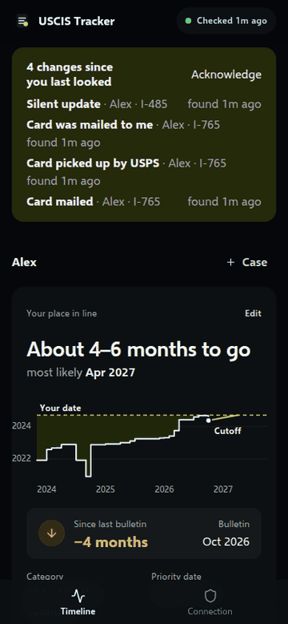

# USCIS Tracker

**Know what moved on your green card case, and when your date comes up.**

**[Open the tracker](https://armanckeser.github.io/uscis-tracker/)** in your browser. Nothing to install, nothing uploaded.

<p align="center">
  
</p>

- One tap from a signed-in myUSCIS tab refreshes every case in your household.
- Shows what changed since your last visit, including silent updates USCIS never announces.
- Estimates when the visa bulletin will reach your priority date.
- Turns codes like `FTA0` into plain words such as "Actively reviewing".
- Keeps your data in your browser, or on your own server if you self-host.

If it helps you, a star helps other people find it, and [armanckeser.com/subscribe](https://armanckeser.com/subscribe) has ways to hear about new releases.

<details>
<summary>Self-host it (push notifications, one shared tracker)</summary>

```bash
docker compose -f oci://ghcr.io/armanckeser/uscis-tracker-stack:latest up -d
```

Open port `8080`; put it behind HTTPS. Details and variables are in [CONTRIBUTING.md](CONTRIBUTING.md#self-hosting).

**From your server's app store:** add the catalog once, then install USCIS Tracker like any other app.

| Server | Where | Paste |
| --- | --- | --- |
| Cosmos | Market → Sources → Add Source | `https://armanckeser.github.io/selfhost-apps/servapps.json` |
| Umbrel | App Store → ⋯ → Community App Stores | `https://github.com/armanckeser/selfhost-apps` |
| CasaOS / ZimaOS | App Store → Add Source | `https://github.com/armanckeser/selfhost-apps/archive/refs/heads/casaos.zip` |
| Runtipi | Settings → App Stores → Add App Store | `https://github.com/armanckeser/selfhost-apps` |
| Portainer | Settings → App Templates → URL | `https://armanckeser.github.io/selfhost-apps/portainer/templates.json` |

Unraid's Community Apps doesn't list it yet; [selfhost-apps](https://github.com/armanckeser/selfhost-apps#add-the-catalog-to-your-server) has the template to add by hand.

</details>

Setup, development and architecture: [CONTRIBUTING.md](CONTRIBUTING.md).

Not affiliated with USCIS or the Department of Homeland Security. Estimates are not legal advice.

## License

Released under the GNU Affero General Public License v3.0, see [LICENSE](LICENSE). If you run a modified version where other people can reach it, the AGPL asks you to publish your changes too.
